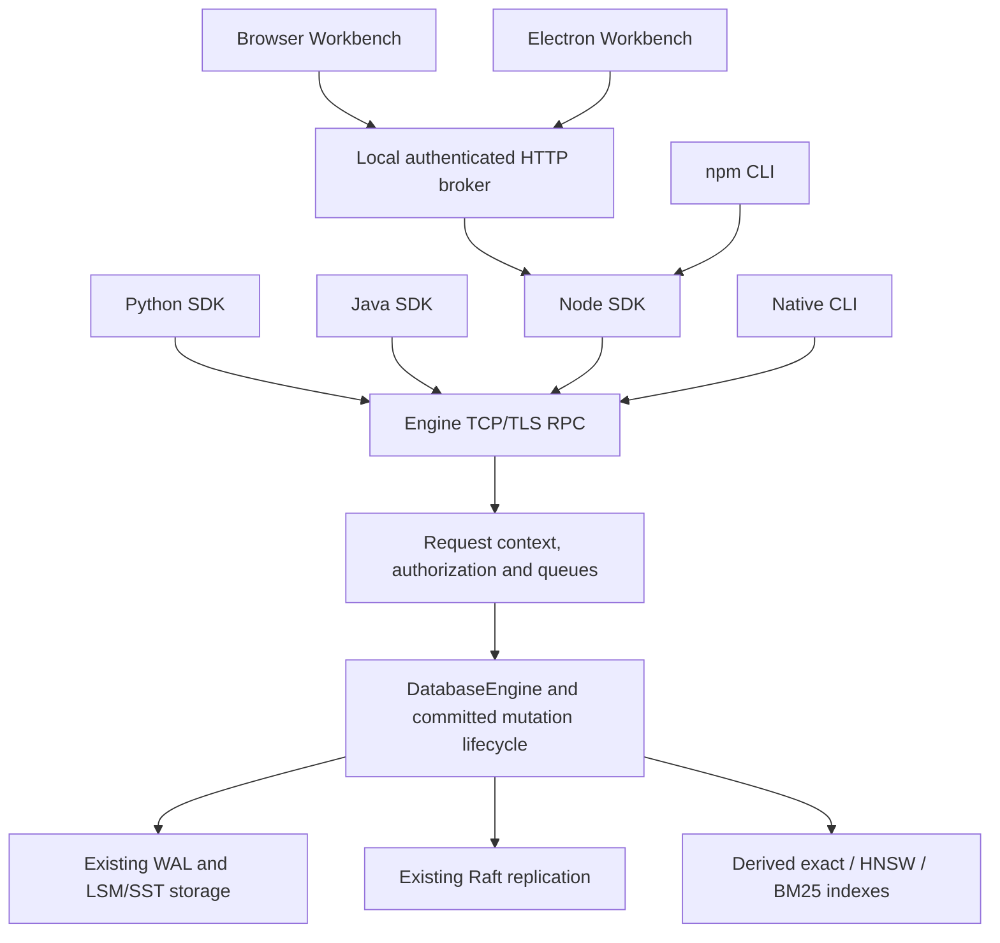

# PacificDB architecture — v1.2

PacificDB is a C++17 unified database engine. Documents, vectors and media share
authoritative storage and committed mutation infrastructure. Clients speak JSON
RPC over TCP or TLS; this release does not introduce an HTTP/gRPC engine API.

The native entry point is `engine/src/main.cpp`; the RPC server is
`engine/src/server.cpp`. Startup resolves explicit configuration, validates and
locks the data root, recovers state, initializes auth/Raft and then serves clients.
The native CLI also manages local engine discovery/startup. The npm CLI requires
an installed native engine or an explicit connection to a running engine.

The browser broker runs on loopback, enforces Host/Origin/session-token checks and
uses a selected SDK connection. Electron disables renderer Node integration and
uses context isolation/sandboxing; its main process owns the bundled engine and
private local broker. Desktop and CLI data directories are distinct by default.
SDKs are transport clients, not embedded engine libraries. Java uses Jackson;
Python has no runtime third-party dependency. Protocol contracts live under
`sdk/contracts`; legacy APIs are retained where compatible.

Vectors are ordinary durable records in the existing WAL/LSM/Raft flow. Dense,
sparse and named values have validation/serialization compatibility rules. Exact
search ranks all eligible rows with bounded retained top-K; packed exact plans are
derived indexes. ANN/HNSW and lexical indexes remain rebuildable, opt-in structures.
The current ANN graph is not persisted: after restart its definition remains but
the graph is ABSENT until explicit rebuilding. Bounded dense incremental history
supports specified changes; stale/lagged/unsupported indexes produce explicit
errors or the configured complete exact fallback. Search can be unavailable during
writes. This release does not add complete distributed vector fan-out/record handoff.

Community media uploads use reserved metadata collections for manifests/chunks;
legacy media file paths also remain. Database and tenant authorization, backup,
snapshot/recovery and quotas are shared infrastructure. Storage encryption is a deployment setting; enabling a vector/index option does
not encrypt existing storage. Configure and verify encryption, authentication and
TLS for the environment where you deploy.

See [the vector usage guide](docs/VECTORS.md),
[release scope](RELEASE_NOTES_v1.2.md#compatibility-and-operation), [installation](INSTALLATION.md) and
[testing](TESTING.md). Historical benchmark results retain their original dev
binary identities and do not automatically qualify a different release artifact.
