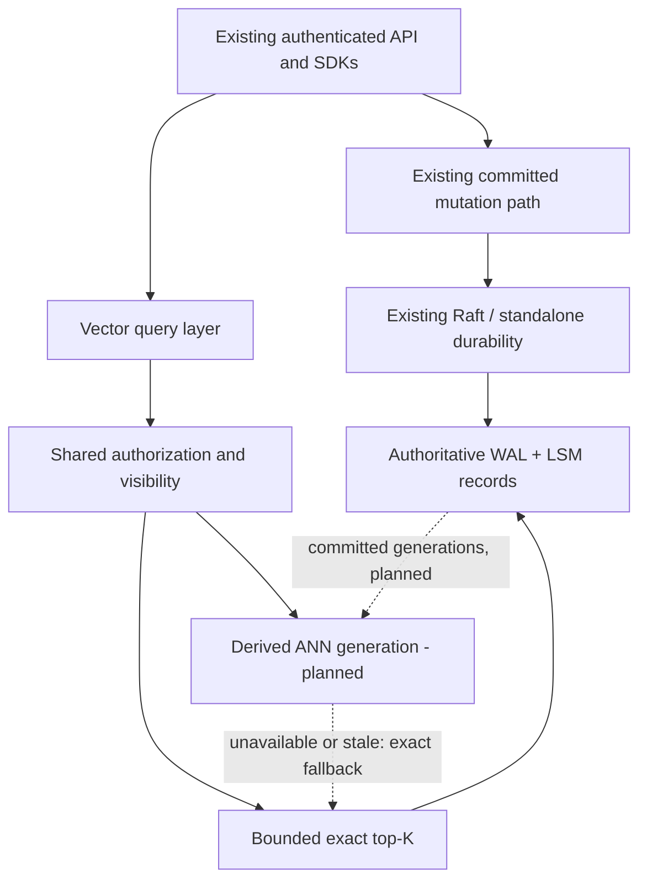

# PacificDB v1.2 vector architecture and acceptance plan

Current unreleased follow-up (2026-11-02): strict requests against an already
initialized incremental HNSW index may wait briefly for a fresh generation.
The public RPC bounds retries by `index_wait_ms` (default 1000, maximum 5000),
the original request deadline, and the same request scan budget. Zero preserves
fail-fast behavior. Only transient freshness failures are retried; permanent
index failures, limits, cancellation and timeouts remain errors. No stale result
or implicit exact fallback is introduced. This is a bounded availability
mitigation, not immutable graph snapshots, persistent ANN or production
qualification. The published RC.2 binary does not contain this change.

Latest qualified checkpoint: [verified authoritative point-cache reuse](V1.2_VERIFIED_POINT_CACHE.md), with [75 top-level checks / 43 CTest cases, five TSAN, four ASan/UBSan and fresh 1M dirty recovery](v1.2-evidence/verified-point-cache-20261101/README.md). The [fresh paired comparison](v1.2-evidence/community-verified-cache-comparison-20261101/REPORT.md) has completed against candidate `86914968...`. The earlier point-read comparison was intentionally stopped before its 1M query/build phases and remains INCOMPLETE. Production release remains INCOMPLETE.

Latest follow-on: [enforced collection schemas and incremental HNSW](V1.2_SCHEMAS_AND_INCREMENTAL_ANN.md). Production release remains **INCOMPLETE**.

Current follow-on implementation: [native vector API preview and packed exact index](V1.2_NATIVE_VECTOR_PREVIEW.md). Earlier checkpoint evidence below remains scoped to its tested revision. Full release: **INCOMPLETE**.

Latest storage capability: [dense, sparse and named vectors](V1.2_DENSE_SPARSE_NAMED_VECTORS.md).

Latest graph prerequisite: [allocation admission report](V1.2_VECTOR_MEMORY_ADMISSION.md).

Subsequent namespace prerequisite: [replicated vector identity](V1.2_VECTOR_REPLICATED_IDENTITY.md).

Follow-on integration: [freshness, catalog and WAL recovery report](V1.2_VECTOR_FRESHNESS_AND_CATALOG.md).

Latest checkpoint: [safety and concurrency report](V1.2_VECTOR_CHECKPOINT_1_SAFETY.md).
The assessment below records the earlier checkpoint; legacy public ANN routing and
process-global request flags described there have now been removed. Full release: INCOMPLETE.

Status: development, INCOMPLETE. Audit date: 2026-10-29. Baseline:
`8732d299008e6cbc581f76e7c2a1eb2f7dad703f`. Branch: `v1.2`.
This is a source audit and implementation plan, not a production certification.

## Initial baseline architecture assessment (before implementation)

| Concern | Actual implementation and integration point |
| --- | --- |
| Public vectors | `server.cpp` dispatches `insertVector` and `queryVector`; Node wrappers and Python/Java operations expose the same actions. Existing response is full documents with `score`. |
| Authoritative storage | `insertVector` validates a numeric array, adds `kind=vector`, then uses ordinary `DatabaseEngine::insert`. `insertMany`, update and remove use the shared mutation paths. Vectors are JSON arrays carried in ordinary documents; binary SST v2 encodes documents as MessagePack. |
| Visibility | `LSM::visitLatest` merges active/immutable memtables and published SSTs, resolving versions/tombstones. It captures the Raft commit index. Document `find/count` additionally apply tenant and `documentVisibleForCurrentRead` checks. Existing vector query omits these additional checks. |
| Exact search | `queryVector` decodes each vector to doubles, materializes every scored document, then copies into a dedup map before nth-element/sort. Candidate retention is collection-sized. Result-document limit incorrectly limits examined candidates. |
| Public ANN | In `database_engine.cpp`, HnswLite is enabled by default. A collection signature scan occurs on every query. Rebuild materializes all documents, compares every earlier pair and sorts per insertion. Global mutex protects all collections and the whole build. Every query copies the graph and its JSON documents. Cache key omits metric/dimensions. |
| Other HNSW | `hnsw_index.cpp` / `read_cache.hpp` contain a separate multilayer float32 class. Compiled but not used by public vector queries. One mutex serializes inserts/search; no proven index persistence, snapshot association or mutation lifecycle. It is not accepted as a production replacement without validation. |
| Mutation / WAL | `DatabaseEngine::insert/insertMany/updateOne/remove` submit existing Raft operations or use existing standalone storage. `LSM::putMany` performs existing WAL append/group durability, memtable/index work and flush scheduling. Stage timings exist. Preserve these paths and acknowledgment settings. |
| Raft | `RaftCore::replicateAndApply`, `applyCommittedOrWait`, `applyCommittedEntries` apply shared operations through `DatabaseEngine::applyRaftEntry`; INSERT_MANY applies via LSM with the committed apply index. Replay is authoritative, not a place to synchronously construct ANN graphs. |
| Snapshots / backups | `LSM::exportSnapshot*`, `applySnapshot`, SnapshotManager/SnapshotBundle and BackupManager capture shared storage and metadata with checksums/restore journaling. Vector documents already participate. Derived ANN must be invalidated/reconstructed against the restored generation. |
| Shards | ShardManager tracks ranges, nodes, load and metadata. `migrateShard` changes metadata; this function alone does not transfer vector records. Public `queryVector` is a local collection query, not distributed shard fan-out. Do not advertise cross-shard search from this scaffold. |
| Secondary indexes | LSM binary column-index segments, manifests, pending update tracking and catalog readiness are distinct from the legacy `Index` map class. Reuse mutation publication principles, do not replace secondary indexes. |
| Authorization | Server action classification, authenticated namespace/access checks, tenant stamping and storage path validation precede operations. Vector execution must preserve them and apply the same row visibility checks as document reads. |
| Resource/concurrency infrastructure | Collection shared mutexes, pinned immutable memtables/SST cursors, WAL queues, Raft apply workers, cancellation tokens, QueryLimiter, MemoryManager and metrics exporters exist. QueryLimiter truncation flags are process-global, a concurrency defect requiring an isolated regression-tested fix. Memory checking is not a complete vector budget. |
| Text / hybrid | Query parser supports TEXT/regex predicates and logical/range/array filters. This is not evidence of a ranked inverted full-text index or BM25. Hybrid ranked retrieval needs an explicit keyword-scoring contract and independent validation. |
| Tests | CMake engine tests, checkpoint crash driver, JS document/media/auth/RF3/restart/disk-full suites, SDK tests and external benchmark bundle. CTest currently registers only a subset; invoke the other existing binaries explicitly. |

## Confirmed gaps and risks

1. All-pairs ANN construction: N(N-1)/2 comparisons (499,999,500,000 at 1M), plus sorting.
2. Per-query collection scan, whole-graph copy and global build lock.
3. Exact retention/materialization O(N), redundant deduplication after `visitLatest`.
4. Exact result limit truncates ranking; cancellation can return an incomplete list without vector-specific indication.
5. Missing row tenant/read visibility checks on vector paths; metric reuse can use a graph built for a different metric.
6. Repeated JSON decode/norm calculation; document representation dominates numeric payload.
7. No validated collection vector schema, sparse/named vector contracts, ANN lifecycle, persistence/rebuild, bounded build resources or distributed vector coordinator.
8. No evidence that ingestion is primarily fsync-bound. Benchmark has 2,000 physical syncs per 1M rows in 500-row batches. Profile existing stage timings before changing shared writes.
9. `visitLatest` snapshots memory and streams pinned SSTs but is not a general historical MVCC iterator: post-resolution filtering cannot recover an older version discarded by resolution. Do not promise historical vector snapshots.
10. Memory snapshots and storage iterator locks remain shared infrastructure costs even after bounded ranking. Bounded top-K alone is not a process-wide memory guarantee.

## Target design and invariants

Authoritative records remain in existing WAL/LSM/Raft. A vector layer validates and
ranks those records through the existing authorization/visibility rules. Existing
document/media records and protocol/storage versions retain their meaning.

Exact search uses a worst-first top-K heap with deterministic score/ID ordering.
Only competitive candidates are materialized inside the current iterator callback;
row views cannot be retained beyond that callback. This first step bounds retained
candidate count without introducing a second point lookup that could return a
different version. Later packed iterators may pin row handles and fetch final
winners. Scan/deadline limits must fail explicitly, never label partial ranking
as exact. Output-document limit limits K, not the corpus considered.

ANN will be a replica-local, derived per-collection/per-vector-space index keyed
by tenant, database, collection, vector name, dimensions, metric and generation.
Committed mutation hooks must cover ordinary inserts/batches/updates/deletes,
Raft apply, recovery, drops and snapshot restore. Generation capture must occur
atomically with storage publication; a counter only on insertVector is insufficient.
Build outside global locks into immutable ownership, atomically publish only a
validated generation. Use a bounded worker queue, memory reservations, cancellation,
and no build work in consensus acknowledgments. States: ABSENT, QUEUED, BUILDING,
READY, STALE, FAILED; expose lag and last error. Exact fallback remains authoritative.

Initial freshness contract: use ANN only when its generation matches a proven
committed view; otherwise use exact search or explicitly reject ANN-only requests.
Later indexed-plus-delta search needs a pinned base generation and versioned
pending mutations, deduplicated before global top-K. Never silently omit updates.
Readiness is conditional on visibility, recovery, recall and budget gates.

Compact format proposal (not yet enabled): a versioned dense float32 / sparse
sorted-index-value encoding inside authoritative document storage with magic,
version, dimension/count, endian definition and length validation. Preserve legacy
arrays on read and old-client responses. Do not rewrite arrays to float32 implicitly:
that changes precision and replica digests. Collection schema/migration must be
committed through existing metadata operations and captured in snapshots. No new
authoritative files or consensus system.

Named spaces must declare dimensions/metric and missing-vector behavior. Sparse
indices must be unique/sorted with finite values and bounded dimensions/nnz. Quantization,
PQ and disk-backed ANN are separate opt-in derived formats after core gates.

Distributed design is shard-local indexing plus coordinator fan-out and deterministic
top-K merge with explicit consistency/read fences, per-shard completeness and errors.
Shard migration needs real ownership/data-transfer semantics before acceptance.

## File-level implementation plan and gates

| Phase | Files / functions | Acceptance before advancing |
| --- | --- | --- |
| 1 audit/baseline | This document; v1.2 development guide; unchanged baseline build and existing tests | Architecture recorded; baseline failures retained |
| 2 exact | `database_engine.cpp::queryVector`; isolated `vector_search.hpp`; vector correctness tests; CMake | Independent reference, limits, ties, tenant/version/tombstone/filter tests; document/media/storage regressions; before/after evidence |
| 2 compact | `storage_format_v2.*`, `lsm.*`, vector codec, catalog metadata | Explicit compatibility contract; corrupt input, WAL, snapshot, RF3 replay, old arrays; blocked until exact gates |
| 3 ANN | New vector index manager / validated HNSW; committed LSM generation hooks; server status APIs | Recall at >=0.95 on held-out corpus; 10K/100K/1M build/latency/memory; crash/publication/restart/concurrent mutation tests |
| 4 capabilities | Vector schema/CRUD/named/sparse; query parser integration; SDK contracts/tests | Durable schema and migration; exact independent references; API compatibility; no invented full-text ranking |
| 5 distributed | Existing routing/Raft/snapshots plus vector coordinator | Real RF3 leader/follower crashes, catch-up, cross-shard completeness, tenant isolation |
| 6 advanced | Separate quantization/disk/planner modules | Individual correctness, recall/resource and recovery gates; optional |
| 7 qualification | Existing scripts plus vector failure/performance matrix | No critical failures; sustained mixed document/media/vector loads; explicit readiness report |

No phase completion implies production readiness. No commits/pushes are authorized.
Release identity remains the released baseline until coordinated v1.2 packaging and
SDK compatibility gates pass; development branch/docs identify v1.2 work separately.

## Native service and hybrid development checkpoint (2026-10-30)

The trusted C++ integration now has a bounded shared index registry, source-memory
reservations, cancellation/deadlines, authoritative candidate revalidation and
composite vector/lexical generation publication. A real derived BM25 inverted index
and ranked RRF hybrid retrieval are implemented and tested internally. Existing
public query modes remain safely gated; these additions are not public production
ANN or distributed retrieval qualification.

Mixed document/media/vector traffic exposed two secondary-index defects: rebuild
lock inversion and delayed queued payloads resurrecting deleted entries. Rebuild and
batch maintenance now use collection-before-index locking; pending IDs resolve the
latest authoritative versions before application. Same-collection writes may wait
through a rebuild; indexed batch maintenance adds point-read I/O. WAL durability and
formats are preserved. Normal and ThreadSanitizer mixed tests pass, and the current
normal CTest suite passes 33/33. The broader post-repair checkpoint passed 62 top-level checks.

See the [implementation, test evidence and qualification boundaries](V1.2_NATIVE_SERVICE_AND_HYBRID.md)
for actual scope, raw failures and scale diagnostics. The release remains INCOMPLETE.

## RC durability follow-through (2026-11-01)

The standalone Raft path now serializes append through durable commit publication
using its existing log ownership, before local apply. It removes rejected tails
before another operation can commit across them, checks synchronous log I/O errors,
and fences uncertain checkpoint publication. The graph remains derived; no vector
store, new consensus layer, numeric migration or WAL fsync relaxation was added.
The tradeoff is less standalone append parallelism during the durable publication
window. Reads and local apply remain outside that lock. Final published-artifact
benchmarks must measure the effect rather than assume a performance improvement.
See [current release verification](../RELEASE_CHECKLIST.md).
